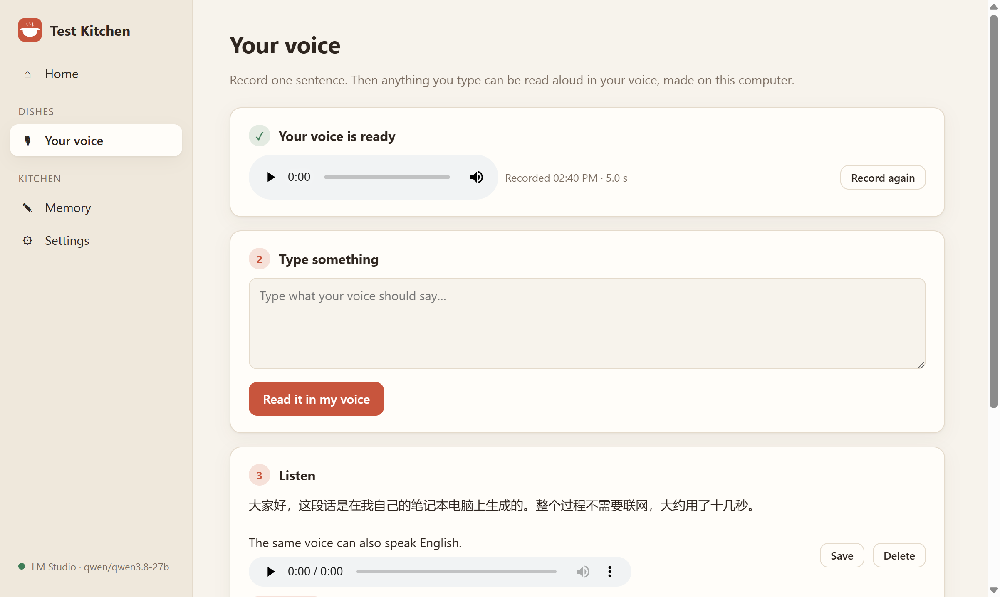

# Cook Your Own AI Assistant

**An agent skill that helps anyone, coder or not, cook a private AI assistant around their own
life: a desktop app on their own computer that runs on local AI models and grows one "dish" for
each real need.**

> "An app can be a home-cooked meal." Robin Sloan, [2020](https://robinsloan.com/notes/home-cooked-app/)



## Why

AI can now write software, and a laptop can now run a capable AI model. So you no longer need a
product made for millions of people. You can have one made for you, around what you actually do:
the video you want to share in another language, the job applications you fill in again and again,
the interview you want to practise for.

Two things stand in the way:

1. **Where to start.** Most people don't know what to ask for, and "an AI assistant" built from a
   template does what the template does, not what you need.
2. **Trust.** An assistant that acts for you can also act wrongly: remember the wrong thing,
   submit a form, send your files somewhere.

This skill is a cook that walks you through both. It runs inside a coding agent (Claude Code,
Codex, Cursor, and others that read [Agent Skills](https://agentskills.io)).

## What happens

| Stage | What the cook does with you |
|---|---|
| 1. **Taste** | Interviews you about your life, not about apps, and writes a needs map: when you need help, what you do today, and which steps must stay yours. |
| 2. **Check the kitchen** | Looks at your computer and picks a local AI model that fits. Every download and install is asked first. |
| 3. **Build the stove** | Builds your app: a window, a tray icon, notifications, a home page ("Waiting for you"), memory that needs your yes, and a connection to the model on your machine. |
| 4. **First dish** | Your own voice: read one sentence, then hear anything you type in your voice. A real result in the first session. |
| 5. **Cook a dish per need** | One feature per need on your map, built with sample data and checked against the kitchen rules before it's served. |
| 6. **Taste again** | After a few days of real use, reads what happened, asks what annoyed you, and adjusts. |

Then the cook leaves. You use your app every day without the coding agent; it runs on your
computer, on your model.

## The kitchen rules

Every dish follows these. They come from a month of living with such an assistant
([field notes](references/field-notes.md)).

1. Nothing is remembered until you confirm it.
2. Steps that can't be undone (send, submit, pay, publish, delete) are always your click.
3. When unsure, it asks: questions wait on the home page instead of guesses.
4. Your data stays on your computer.
5. Dishes are built and tested with sample data, not yours.
6. On other people's platforms it reads and prepares; it doesn't act in bulk for you.
7. What the AI made in your name is labelled as AI-made, and only your own voice can be cloned.

## Install

With the [skills CLI](https://github.com/vercel-labs/skills):

```
npx skills add TonyZou35-sketch/cook-your-own-ai-assistant
```

Or copy this repository into your agent's skills folder, for Claude Code:

```
git clone https://github.com/TonyZou35-sketch/cook-your-own-ai-assistant ~/.claude/skills/cook-your-own-ai-assistant
```

Then open your coding agent in any folder and say:

> I'd like to cook my own AI assistant.

## What you need

- A coding agent that can run commands on your computer.
- Disk space: about 1 GB for the app and the voice dish, plus your language model (2–40 GB
  depending on the model).
- LM Studio or Ollama for the language model (the cook helps you install one).
- **Tested on Windows 11** (AMD Ryzen AI Max+ 395, 128 GB). macOS and Linux paths are written but
  not yet tested; reports welcome.

## Where it comes from

One interaction-design student cooked their own assistant over a month in 2026 and used it every
day. It ended up with seven dishes: Chinese subtitles for videos worth sharing, a job-search
helper, an interview review, a voice mock interviewer, memory, a "where was I" recap, and a narrator
in their own cloned voice. This skill is that process, written down so others can cook theirs. The
dishes themselves stay personal; only the voice dish ships as a recipe, because almost anyone can
use it.

## Inside

```
SKILL.md                  the cook's instructions (start here if you're curious)
references/               kitchen rules, one guide per stage, field notes
scripts/check-kitchen.mjs what this computer can run (reads only)
templates/kitchen-app/    the app every kitchen starts from (Electron + a small local server)
recipes/voice-clone/      the first dish, its setup, and an English pronunciation list
```

## License

MIT for this repository. The speech models the voice recipe downloads keep their own licenses;
see [recipes/voice-clone/RECIPE.md](recipes/voice-clone/RECIPE.md).
